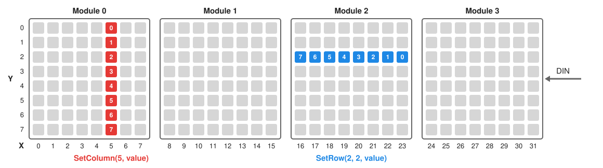

# MaxMatrix

[](https://github.com/theAndreas/MaxMatrix/actions/workflows/ci.yml)
[](https://github.com/theAndreas/MaxMatrix/actions/workflows/static-analysis.yml)
[](https://github.com/theAndreas/MaxMatrix/issues)

[](LICENSE)
[](https://github.com/theAndreas/MaxMatrix/releases)

This is an Arduino library for chained 8x8 LED dot matrix modules driven by the MAX7219.
The reference of every class and function is on [GitHub Pages](https://theandreas.github.io/MaxMatrix/).

Features:

- set and get single dots, rows and columns, in the same coordinates on every type of module
- print chars and text (ASCII 32 to 126, the German umlauts, ß and °, variable char width)
- shift a char or a text over the matrix without blocking `loop()`, at a pace the library keeps
- shift the matrix content left, right, up and down, with or without rotation
- send a picture drawn with many calls at once, in at most eight frames
- module orientation of 0, 90, 180 and 270 degrees, and a board mounted upside down
- bit banging (any pins) or hardware SPI
- a simulator that runs the examples on the PC, in the terminal or in a browser
- a control program for Linux and Windows that drives a board or the simulator over SerialControl

## Installation
Download the repository as ZIP and add it in the Arduino IDE with *Sketch > Include Library > Add .ZIP Library...*,
or clone it into your `Arduino/libraries` folder.

## Wiring

| Module | Arduino Uno / Nano |
|--------|--------------------|
| VCC    | 5V                 |
| GND    | GND                |
| DIN    | 11                 |
| CS     | 10                 |
| CLK    | 13                 |

In bit banging mode any digital pins can be used. With hardware SPI, DIN and CLK must be connected to the SPI pins of the board (MOSI and SCK).

## Configuration
The configuration is done in [src/MaxMatrixConfig.h](src/MaxMatrixConfig.h):

| Parameter                                  | Default   | Description                                           |
|--------------------------------------------|-----------|-------------------------------------------------------|
| `MAXMATRIX_USE_SPI`                        | `STD_OFF` | use hardware SPI instead of bit banging on any pins   |
| `MAXMATRIX_SPI_CLOCK_SPEED`                | `10000000`| SPI clock, the MAX7219 supports max. 10 MHz           |
| `MAXMATRIX_SPACE_BETWEEN_CHARS_INIT_VALUE` | `1`       | empty columns between chars                           |
| `MAXMATRIX_INTENSITY_INIT_VALUE`           | `5`       | LED intensity after `Init()` (0 to 15)                |
| `MAXMATRIX_SHIFT_INTERVAL_INIT_VALUE`      | `50`      | ms per column of a shifting text, `0` for every call  |
| `MAXMATRIX_COMMAND_LINE_LENGTH`            | `64`      | longest command line of `MaxMatrixCommand`, in chars   |
| `MAXMATRIX_DEV_ERROR_DETECT`               | `STD_OFF` | report every failed call, see [Functions](#functions)  |

The length of the chain is not configured here but in the sketch, where the Arduino IDE lets it change: `MaxMatrixOf<4>`
is a matrix of four modules and brings their buffer, eight bytes per module, and `MaxMatrixOf<8>` one of eight, up to 31.
A chain whose length is known only at run time hands `MaxMatrix` a buffer of its own:

```cpp
byte buffer[MAXMATRIX_BUFFER_SIZE(6)];
MaxMatrix matrix(11, 10, 13, buffer, 6);
```

## Usage

```cpp
#include <MaxMatrix.h>

MaxMatrixOf<4> matrix(11, 10, 13);   // a chain of 4 modules at DIN, CS, CLK
char text[] = "Hello World!   ";

void setup()
{
    matrix.Init();
    matrix.SetModuleOrientation(MaxMatrixModuleOrientation::k270);    // FC-16, see "Module orientation"
    matrix.SetTextWithShift(text);
}

void loop()
{
    matrix.ShiftTask();     // shifts the text one column every 50 ms
    if(matrix.GetState() == MaxMatrixState::kReady) matrix.SetTextWithShift(text);
}
```

`ShiftTask()` keeps the pace itself: call it on every `loop()`, and it takes a step only when the shift interval has
passed since the last one. `SetShiftInterval()` sets the interval in milliseconds per column; with `0` every call is a
step, for a sketch that times the steps itself. A call that comes late, because `loop()` was busy, takes one step and
does not catch up.

`SetTextWithShift()` only stores a pointer to the text, so the text has to stay valid until the state changes back to `MaxMatrixState::kReady`.

More examples can be found in [examples/](https://github.com/theAndreas/MaxMatrix/tree/main/examples/):

| Example | Shows |
|---|---|
| [Basics](https://github.com/theAndreas/MaxMatrix/blob/main/examples/Basics/Basics.ino) | text, dots, rows, a picture drawn in one go, the intensity |
| [ScrollText](https://github.com/theAndreas/MaxMatrix/blob/main/examples/ScrollText/ScrollText.ino) | one text scrolling endlessly, without blocking `loop()` |
| [Messages](https://github.com/theAndreas/MaxMatrix/blob/main/examples/Messages/Messages.ino) | several texts in turn, each at its own speed, with umlauts |
| [Animation](https://github.com/theAndreas/MaxMatrix/blob/main/examples/Animation/Animation.ino) | a ball bouncing off the edges, one picture per step |
| [Sprites](https://github.com/theAndreas/MaxMatrix/blob/main/examples/Sprites/Sprites.ino) | a sprite of its own walking across, with two frames |
| [SerialControl](https://github.com/theAndreas/MaxMatrix/blob/main/examples/SerialControl/SerialControl.ino) | the matrix controlled by lines of text over `Serial` |

## Coordinates



`SetDot(x, y)` counts x from the left and y from the top, across all modules: x from 0 to
`GetNumberOfColumns() - 1`, eight columns per module, y from 0 to 7. Module 0 is the leftmost, at the far end of the chain from DIN.
This holds for every type of module once the orientation fits it, see [Module orientation](#module-orientation).

The two functions that set eight LEDs at once read their byte in different directions:

- `SetColumn(x, value)` sets a column, **bit 0 at the top**.
- `SetRow(module, row, value)` sets the row of one module, **bit 7 on the left**, so the byte reads as it is
  written: `0b10000000` lights the leftmost LED. `SetRow(row, values)` sets a whole row, one byte per module,
  module 0 first.

## Functions

| Function | What it does |
|----------|--------------|
| `Init()` | sets up the pins and every MAX7219, clears the LEDs and sets the intensity |
| `Clear()` | turns every LED off |
| `SetDot(x, y, value)`, `GetDot(x, y)` | one LED |
| `SetColumn(x, value)`, `SetColumn(module, column, value)`, `GetColumn(…)` | a column, bit 0 at the top |
| `SetRow(row, values)`, `SetRow(module, row, value)`, `GetRow(…)` | a row, bit 7 on the left |
| `SetChar(x, y, c)`, `SetText(text)` | a char at x, y, or a text from the left edge |
| `SetSprite(x, y, sprite)` | a sprite of your own, up to 5 columns wide |
| `SetFont(font)`, `GetFont()` | the font every char is drawn in, see [below](#fonts) |
| `SetCharWithShift(c)`, `SetTextWithShift(text)`, `ShiftTask()`, `GetState()` | a char or a text that shifts in from the right |
| `SetShiftInterval(milliseconds)`, `SetSpaceBetweenChars(columns)` | how fast a text shifts and how far apart its chars are |
| `ShiftLeft()`, `ShiftRight()`, `ShiftUp()`, `ShiftDown()` | moves the whole picture by one dot, rotating or filling up |
| `GetNumberOfModules()`, `GetNumberOfColumns()` | the length of the chain, eight columns per module |
| `SetIntensity(intensity)` | brightness of every module, 0 to 15 |
| `SetShutdown(on)` | turns the LEDs off without losing the picture, which still takes what is drawn |
| `SetDisplayTest(on)` | lights every LED at full brightness, to check the modules, and shows the picture again |
| `MaxMatrixBatch`, `SetAutoUpdate(on)`, `Update()` | holds the sending back, see [below](#drawing-a-picture-in-one-go) |
| `SetModuleOrientation(…)`, `SetMatrixOrientation(…)` | fits the coordinates to the module, see [below](#module-orientation) |
| `RegisterWrite(address, value)` | writes a register of every MAX7219, past the picture |
| `MaxMatrixCommand`, `Feed(matrix, c, answer)` | carries out commands that arrive as lines of text, see [below](#control-over-serial) |

Drawing leaves out whatever lies off the panel, so that a sprite or a text may stand partly off it while it moves
in or out: `SetDot(-1, 0, true)` does nothing, and a char at x = -2 shows its right part. x and y may be negative.
A function that can fail says why, and changes nothing when it does. A getter returns the value together with the
error, so ask `IsOk()` before you use `GetValue()`:

```cpp
MaxMatrixResult<bool> lit = matrix.GetDot(x, y);
if(lit.IsOk() && lit.GetValue()) { /* the LED at x, y is on */ }

MaxMatrixStatus status = matrix.SetText(text);
if(status == MaxMatrixError::kUnknownChar) { /* the font lacks a char of Text */ }
```

The errors are `MaxMatrixError::kOutOfRange`, `MaxMatrixError::kUnknownChar` and `MaxMatrixError::kNoText`, and from
`MaxMatrixCommand` also `MaxMatrixError::kNotANumber`, `MaxMatrixError::kUnknownCommand` and `MaxMatrixError::kLineTooLong`;
`MaxMatrixError::kOk` means none. A status is not a `bool`: write `Status.IsOk()`, not `if(Status)`.
`Serial.println(Status.GetErrorText())` prints the error in words, such as `out of range`; the texts lie in flash,
and a sketch that never asks for one does not carry them.

To find a call that fails where the sketch checks nothing, switch `MAXMATRIX_DEV_ERROR_DETECT` to `STD_ON`: in
`MaxMatrixConfig.h`, as the Arduino IDE passes no define of a sketch to a library, or with arduino-cli as
`--build-property "compiler.cpp.extra_flags=-DMAXMATRIX_DEV_ERROR_DETECT=STD_ON"`. Every function that fails then
prints a line on `Serial`, such as `MaxMatrix SetText: unknown char`, so call `Serial.begin()` in `setup()`. A sketch
whose `Serial` carries something else, or which would rather blink or halt, defines the report itself, and the one
that prints is left out:

```cpp
void MaxMatrixReportError(__FlashStringHelper const* api, MaxMatrixError error)
{
    digitalWrite(LED_BUILTIN, HIGH);
}
```

Switched off, as it is by default, the reports cost nothing. Switched on, `Basics` grows by 1158 bytes of flash and
179 of RAM, most of it `Serial`; with a report of its own, by little more than the names of the functions it calls.
In SerialControl a `text=` with a char the font lacks is then reported as well, in a line before its answer.

## Drawing a picture in one go
Every call that draws shows its result before it returns, and sends only what it changed: at most eight frames to
the chain, however much it drew. A picture made of many calls would still be shown half drawn in between. For that,
draw it inside a block that starts with a `MaxMatrixBatch`; the picture is sent at the end of the block:

```cpp
{
    MaxMatrixBatch batch(matrix);   // nothing is sent until the end of this block
    matrix.Clear();
    for(byte column = 0; column < matrix.GetNumberOfColumns(); column++) matrix.SetDot(column, column % 8, true);
}                                   // the whole picture at once, in at most eight frames
```

The batch needs a name: `MaxMatrixBatch{Matrix};` on its own is gone again before the next line and holds nothing
back. Batches can be nested; only the outermost one sends.

A picture that is built over several calls of `loop()` does not fit into a block. There, turn the automatic update
off with `SetAutoUpdate(false)` and send with `Update()` whenever the picture is complete.

`SetIntensity()` takes effect at once either way. `Init()` always clears the LEDs, whatever the setting.

## Control over Serial
`MaxMatrixCommand` carries out commands that arrive as lines of text, one command per line:

| Command | What it does |
|---------|--------------|
| `text=Hello` | shows a text from the left edge, on a cleared matrix |
| `textShift=Hello` | shifts a text in from the right |
| `intensity=8` | brightness, 0 to 15 |
| `speed=50` | milliseconds per column of a shifting text |
| `space=1` | empty columns between chars |
| `setDot=5,3,1` | column, row, `1` for on and `0` for off |
| `clear` | turns every LED off |
| `picture` | answers with what the matrix shows |

A line ends in `\n` or `\r\n`. `Feed()` answers each line on the `Print` it is given, as a rule `Serial`, with one line:
`ok`, or `error: ` and the reason, or for `picture` with `picture=` and two hex digits per column, from the left as the
viewer sees it, bit 0 the top row. The [SerialControl](https://github.com/theAndreas/MaxMatrix/blob/main/examples/SerialControl/SerialControl.ino) example reads the lines from `Serial` at 115200 baud; the serial monitor of the
Arduino IDE sends them with "Newline" as line ending:

```cpp
MaxMatrixCommand command;

void loop()
{
    while(Serial.available() > 0) command.Feed(matrix, Serial.read(), Serial);
    matrix.ShiftTask();
}
```

`Feed()` also returns what became of the line: `MaxMatrixCommandState::kPending` while it goes on,
`MaxMatrixCommandState::kDone` when it is carried out, `MaxMatrixCommandState::kAnswered` after `picture`, and
why it failed otherwise: `intensity=16` is `MaxMatrixError::kOutOfRange`, `intensity=x` `MaxMatrixError::kNotANumber`. A line
longer than `MAXMATRIX_COMMAND_LINE_LENGTH` is dropped whole rather than carried out cut short. The class keeps the
line and the text of `textShift=`, so it takes twice that length in RAM; a sketch that does not use it pays nothing.

The simulator's page has buttons for the commands, and a click on an LED switches it. They drive the simulator when it
runs SerialControl, and a board running SerialControl as well, connected with *Connect board* over the browser's Web
Serial API: every command goes to both, so the panel shows what the board should. Web Serial needs Chrome or Edge, and
the page served by the simulator on `localhost` is enough for it, even with a board alone:

```sh
build/Simulator-SerialControl-bitbang --web
```

Opening the port resets an Uno; the page sends the board nothing until SerialControl has said `ready`.

### The control program
`control/` holds the same controls as a program of its own, for a browser without Web Serial and for whoever wants a
window rather than a page, laid out as the Windows tool of [Led-Matrix](https://github.com/AndreasBur/Led-Matrix) was,
but for its tabs: the whole panel on top, below it the text, *Shift in*, the space and the intensity and speed
sliders, and on the right the board's serial port, the simulator and a log of every line and answer. Every command goes
to the board and to the simulator, whichever is connected.

The panel shows what the board shows, or the simulator while no board is ready: the program asks SerialControl for
its `picture` up to twenty times a second, so a text that shifts in moves there as well, and a click switches the LED
that is lit or dark on the matrix; moved with the button held, the mouse paints every LED it passes the way the first
one went. Beside the text the window counts the bytes it may still take in SerialControl's line, an umlaut two, and
sends no line that would be dropped. When SerialControl starts, or the simulator is connected, the program sends it the
intensity, speed and space the window shows.

It is built with the rest when CMake finds wxWidgets 3.2 (`apt install libwxgtk3.2-dev`, in the dev container
already), and runs the simulator over a TCP port that `--tcp` opens beside the page:

```sh
build/Simulator-SerialControl-bitbang --tcp 8081 &
build/control/MaxMatrixControl
```

On Windows, `cmake -S control -B build-control` is meant to build the program alone, against a wxWidgets found by CMake;
its serial port and socket code compile with MinGW, but the program has not been built or run on Windows yet. The board's ports are listed as `COM` ports there and as `/dev/ttyACM*` and `/dev/ttyUSB*` on Linux; another name can
be typed into the box. As on the page, nothing goes to a board until SerialControl has said `ready`.

## Module orientation
Two settings make the text upright:

- `SetModuleOrientation()` turns every module in its place by 0, 90, 180 or 270 degrees. Depending on how the LED matrix is mounted on the module, the columns of the MAX7219 are horizontal or vertical, and this setting follows from the type of module.
- `SetMatrixOrientation()` turns the whole display by 0 or 180 degrees, for a board mounted upside down, with the input (DIN) on the left.

Modules are named here as in [MD_MAX72XX](https://github.com/MajicDesigns/MD_MAX72XX), whose hardware types describe the same wiring:

| Module | Module orientation |
|--------|--------------------|
| FC-16 (`FC16_HW`), the common 4-in-1 boards | `MaxMatrixModuleOrientation::k270` (checked on hardware) |
| ICStation (`ICSTATION_HW`) | `MaxMatrixModuleOrientation::k90` |
| Generic (`GENERIC_HW`) | `MaxMatrixModuleOrientation::k180` |
| `DR0CR0RR1_HW` | `MaxMatrixModuleOrientation::k0` |

With the input on the right, the matrix orientation stays at `MaxMatrixMatrixOrientation::k0`; mounted upside down, it is `MaxMatrixMatrixOrientation::k180` with the same module orientation. Parola modules (`PAROLA_HW`) are a mirror image of these and cannot be shown upright yet.

How the bytes of the MAX7219 lie on the LEDs in each module orientation is drawn in [docu/](docu/README.md); a sketch
does not need it, only work on the library does.

## Umlauts
The German umlauts Ä, Ö, Ü, ä, ö and ü, the ß and the degree sign ° are supported in texts. `SetText()` and `SetTextWithShift()` accept UTF-8 (the encoding of the Arduino IDE) and ISO 8859-1.
`SetChar()` and `SetCharWithShift()` take a single `char`, so these have to be passed as ISO 8859-1 code there, e.g. `'\xE4'` for ä, `'\xDF'` for ß or `'\xB0'` for °.
The € is not in ISO 8859-1, and its three bytes of UTF-8 are not read.
While shifting a text, chars which are not part of the font are skipped.

## Fonts
A font is an array of bytes in flash, in the font format of [MD_MAX72XX](https://github.com/MajicDesigns/MD_MAX72XX),
so that its fonts and its font builder serve here as well: `'F'`, the version, the code of the first char, that of
the last, and the height in rows, and then every char from the first to the last as its width and that many columns,
bit 0 the top row. A char of width 0 is not in the font. Version 1 gives each code in one byte, version 2 in two, high
byte first. A char may be wider than a sprite's 5 columns.

```cpp
uint8_t const kDigits[] PROGMEM = {
    'F', 1, '0', '1', 7,                // version 1, the chars 0 to 1, 7 rows high
    3, B00111110, B01000001, B00111110, // 0
    2, B01000010, B01111111,            // 1
};

matrix.SetFont(kDigits);                // MaxMatrixError::kNotAFont for an array that does not start as a font
matrix.SetText("10");
matrix.SetFont(kMaxMatrixDefaultFont);  // the font MaxMatrix starts with
```

The font has to stay where it is as long as it is set, as a `PROGMEM` array does. Chars are looked up by their latin-1
code, the one `DecodeChar()` makes of UTF-8. The default font holds ASCII and the chars of [Umlauts](#umlauts), 8 rows
high, in 614 bytes; a sketch that draws no char does not link it.

## Development
The host-side tests build the library against a mock of the Arduino core, once with bit banging and once with SPI:

```sh
cmake --workflow --preset default
```

They need `g++`, CMake, Ninja and GoogleTest (`apt install cmake ninja-build libgtest-dev`). Compiling the examples with the real AVR toolchain needs `arduino-cli` with the `arduino:avr` core:

```sh
arduino-cli compile --fqbn arduino:avr:uno --library . examples/ScrollText
```

Both run in CI on every pull request, together with `arduino-lint`.

Every example also builds into a simulator, which runs the sketch unchanged on the PC and draws the panel in the terminal, as a module of the given type would show it:

```sh
build/Simulator-ScrollText-bitbang --wiring FC16
```

`--wiring` takes `FC16` (the default), `GENERIC`, `PAROLA`, `ICSTATION` or `DR0CR0RR0` to `DR1CR1RR1`, and `--upside-down` turns the board around. A sketch with the wrong orientation for the module shows the text turned or mirrored, as the hardware would.

With `--web` it draws in a browser instead, on <http://localhost:8080/>, which VS Code forwards out of the dev container: the panel with the brightness of every module, the frames on the wire, the module type and mounting to switch while the sketch runs, and the controls of [Control over Serial](#control-over-serial). `--port` picks another port, for a second simulator beside it. `--tcp PORT` opens the sketch's `Serial` as a TCP port on `localhost`, for [the control program](#the-control-program): what it sends, the sketch reads, and what the sketch prints, it gets back.

`build/SimulatorAvr` runs the same, but with the binary avr-gcc made for the Uno rather than with the sketch built for
the PC: [simavr](https://github.com/buserror/simavr) simulates the ATmega328P, and its pins and SPI drive the MAX7219
model. CMake builds the examples for it with `arduino-cli` into `build/avr/` when it finds both:

```sh
build/SimulatorAvr --elf build/avr/bitbang/ScrollText/ScrollText.ino.elf --wiring FC16
```

[Wokwi](https://wokwi.com) runs the real AVR binary as well, on a simulated Uno with four FC-16 modules at pins 11, 10
and 13, so that the bit banging and the SPI of the board are what drive the LEDs. `diagram.json` and `wokwi.toml` in
the root describe that board; build an example into the file `wokwi.toml` names and start it with *Wokwi: Start
Simulator* from the [Wokwi extension](https://docs.wokwi.com/vscode/getting-started) for VS Code, which is free for
open source:

```sh
tools/wokwi.py Sprites          # or with --spi, for hardware SPI on the same pins
```

Wokwi has two of the eight module types (FC-16 and Parola) and shows no frames; the simulator above covers those.

The pictures in [docu/](docu/README.md) are drawn from the library and the MAX7219 model, not by hand. After a change
that moves a dot, `build/DocuPictures --write docu` draws them again; until then the test `docu/pictures` fails.
