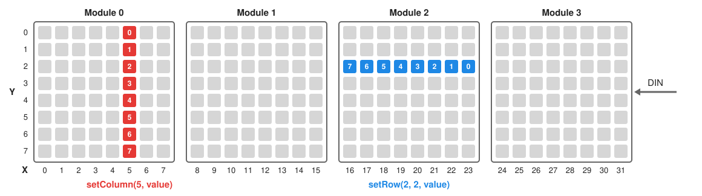

# MaxMatrix

[](https://github.com/theAndreas/MaxMatrix/actions/workflows/ci.yml)
[](https://github.com/theAndreas/MaxMatrix/issues)

[](LICENSE)
[](https://github.com/theAndreas/MaxMatrix/releases)

This is an Arduino library for chained 8x8 LED dot matrix modules driven by the MAX7219.

Features:

- set and get single dots, rows and columns, in the same coordinates on every type of module
- print chars and text (ASCII 32 to 126 and German umlauts, variable char width)
- shift a char or a text over the matrix without blocking `loop()`, at a pace the library keeps
- shift the matrix content left, right, up and down, with or without rotation
- send a picture drawn with many calls at once, in at most eight frames
- module orientation of 0, 90, 180 and 270 degrees, and a board mounted upside down
- bit banging (any pins) or hardware SPI
- a simulator that runs the examples on the PC, in the terminal or in a browser

## Installation
Download the repository as ZIP and add it in the Arduino IDE with *Sketch > Include Library > Add .ZIP Library...*,
or clone it into your `Arduino/libraries` folder.

## Wiring

| Module | Arduino Uno / Nano |
|--------|--------------------|
| VCC    | 5V                 |
| GND    | GND                |
| DIN    | 11                 |
| CS     | 10                 |
| CLK    | 13                 |

In bit banging mode any digital pins can be used. With hardware SPI, DIN and CLK must be connected to the SPI pins of the board (MOSI and SCK).

## Configuration
The configuration is done in [src/MaxMatrixConfig.h](src/MaxMatrixConfig.h):

| Parameter                                  | Default   | Description                                           |
|--------------------------------------------|-----------|-------------------------------------------------------|
| `MAXMATRIX_NUMBER_OF_MODULES`              | `4`       | number of chained 8x8 modules                         |
| `MAXMATRIX_USE_SPI`                        | `STD_OFF` | use hardware SPI instead of `shiftOut()`              |
| `MAXMATRIX_SPI_CLOCK_SPEED`                | `10000000`| SPI clock, the MAX7219 supports max. 10 MHz           |
| `MAXMATRIX_USE_DIGITAL_WRITE_FAST`         | `STD_OFF` | meant for the digitalWriteFast library; has no effect yet, see [OIL.md](OIL.md) item 22 |
| `MAXMATRIX_SPACE_BETWEEN_CHARS_INIT_VALUE` | `1`       | empty columns between chars                           |
| `MAXMATRIX_INTENSITY_INIT_VALUE`           | `5`       | LED intensity after `init()` (0 to 15)                |
| `MAXMATRIX_SHIFT_INTERVAL_INIT_VALUE`      | `50`      | ms per column of a shifting text, `0` for every call  |
| `MAXMATRIX_COMMAND_LINE_LENGTH`            | `64`      | longest command line of `MaxMatrixCommand`, in chars   |

## Usage

```cpp
#include <MaxMatrix.h>

MaxMatrix Matrix(11, 10, 13);   // DIN, CS, CLK
char Text[] = "Hello World!   ";

void setup()
{
    Matrix.init();
    Matrix.setModuleOrientation(MAXMATRIX_MODULE_ORIENTATION_270);    // FC-16, see "Module orientation"
    Matrix.setTextWithShift(Text);
}

void loop()
{
    Matrix.shiftTask();     // shifts the text one column every 50 ms
    if(Matrix.getState() == MAXMATRIX_STATE_READY) Matrix.setTextWithShift(Text);
}
```

`shiftTask()` keeps the pace itself: call it on every `loop()`, and it takes a step only when the shift interval has
passed since the last one. `setShiftInterval()` sets the interval in milliseconds per column; with `0` every call is a
step, for a sketch that times the steps itself. A call that comes late, because `loop()` was busy, takes one step and
does not catch up.

`setTextWithShift()` only stores a pointer to the text, so the text has to stay valid until the state changes back to `MAXMATRIX_STATE_READY`.

More examples can be found in [examples/](examples/).

## Coordinates



`setDot(X, Y)` counts X from the left and Y from the top, across all modules: X from 0 to
`MAXMATRIX_NUMBER_OF_COLUMNS - 1`, Y from 0 to 7. Module 0 is the leftmost, at the far end of the chain from DIN.
This holds for every type of module once the orientation fits it, see [Module orientation](#module-orientation).

The two functions that set eight LEDs at once read their byte in different directions:

- `setColumn(X, Value)` sets a column, **bit 0 at the top**.
- `setRow(Module, Row, Value)` sets the row of one module, **bit 7 on the left**, so the byte reads as it is
  written: `0b10000000` lights the leftmost LED. `setRow(Row, Values)` sets a whole row, one byte per module,
  module 0 first.

## Functions

| Function | What it does |
|----------|--------------|
| `init()` | sets up the pins and every MAX7219, clears the LEDs and sets the intensity |
| `clear()` | turns every LED off |
| `setDot(X, Y, Value)`, `getDot(X, Y, &Value)` | one LED |
| `setColumn(X, Value)`, `setColumn(Module, Column, Value)`, `getColumn(…)` | a column, bit 0 at the top |
| `setRow(Row, Values)`, `setRow(Module, Row, Value)`, `getRow(…)` | a row, bit 7 on the left |
| `setChar(X, Y, Char)`, `setText(Text)` | a char at X, Y, or a text from the left edge |
| `setSprite(X, Y, Sprite)`, `getSprite(Index, &Sprite)` | a sprite of the font, or one of your own |
| `setCharWithShift(Char)`, `setTextWithShift(Text)`, `shiftTask()`, `getState()` | a char or a text that shifts in from the right |
| `setShiftInterval(Milliseconds)`, `setSpaceBetweenChars(Columns)` | how fast a text shifts and how far apart its chars are |
| `shiftLeft()`, `shiftRight()`, `shiftUp()`, `shiftDown()` | moves the whole picture by one dot, rotating or filling up |
| `setIntensity(Intensity)` | brightness of every module, 0 to 15 |
| `MaxMatrixBatch`, `setAutoUpdate(On)`, `update()` | holds the sending back, see [below](#drawing-a-picture-in-one-go) |
| `setModuleOrientation(…)`, `setMatrixOrientation(…)` | fits the coordinates to the module, see [below](#module-orientation) |
| `RegisterWrite(Address, Value)` | writes a register of every MAX7219, past the picture |
| `MaxMatrixCommand`, `feed(Matrix, Char)` | carries out commands that arrive as lines of text, see [below](#control-over-serial) |

A function that can fail returns `E_OK` or `E_NOT_OK`; a coordinate out of range changes nothing.

## Drawing a picture in one go
Every call that draws shows its result before it returns, and sends only what it changed: at most eight frames to
the chain, however much it drew. A picture made of many calls would still be shown half drawn in between. For that,
draw it inside a block that starts with a `MaxMatrixBatch`; the picture is sent at the end of the block:

```cpp
{
    MaxMatrixBatch Batch(Matrix);   // nothing is sent until the end of this block
    Matrix.clear();
    for(byte Column = 0; Column < MAXMATRIX_NUMBER_OF_COLUMNS; Column++) Matrix.setDot(Column, Column % 8, true);
}                                   // the whole picture at once, in at most eight frames
```

The batch needs a name: `MaxMatrixBatch{Matrix};` on its own is gone again before the next line and holds nothing
back. Batches can be nested; only the outermost one sends.

A picture that is built over several calls of `loop()` does not fit into a block. There, turn the automatic update
off with `setAutoUpdate(false)` and send with `update()` whenever the picture is complete.

`setIntensity()` takes effect at once either way. `init()` always clears the LEDs, whatever the setting.

## Control over Serial
`MaxMatrixCommand` carries out commands that arrive as lines of text, one command per line:

| Command | What it does |
|---------|--------------|
| `text=Hello` | shows a text from the left edge, on a cleared matrix |
| `textShift=Hello` | shifts a text in from the right |
| `intensity=8` | brightness, 0 to 15 |
| `speed=50` | milliseconds per column of a shifting text |
| `space=1` | empty columns between chars |
| `setDot=5,3,1` | column, row, `1` for on and `0` for off |
| `clear` | turns every LED off |

A line ends in `\n` or `\r\n`. The [SerialControl](examples/SerialControl/SerialControl.ino) example reads them from
`Serial` at 115200 baud and answers each with `ok` or `error`; the serial monitor of the Arduino IDE sends them with
"Newline" as line ending:

```cpp
MaxMatrixCommand Command;

void loop()
{
    while(Serial.available() > 0) {
        MaxMatrixCommandResultType Result = Command.feed(Matrix, Serial.read());
        if(Result == MAXMATRIX_COMMAND_DONE) Serial.println(F("ok"));
        else if(Result != MAXMATRIX_COMMAND_PENDING) Serial.println(F("error"));
    }
    Matrix.shiftTask();
}
```

`feed()` tells an unknown command, a wrong value and a line too long apart, for a sketch that wants to say more than
`error`. A line longer than `MAXMATRIX_COMMAND_LINE_LENGTH` is dropped whole rather than carried out cut short. The
class keeps the line and the text of `textShift=`, so it takes twice that length in RAM; a sketch that does not use it
pays nothing.

## Module orientation
Two settings make the text upright:

- `setModuleOrientation()` turns every module in its place by 0, 90, 180 or 270 degrees. Depending on how the LED matrix is mounted on the module, the columns of the MAX7219 are horizontal or vertical, and this setting follows from the type of module.
- `setMatrixOrientation()` turns the whole display by 0 or 180 degrees, for a board mounted upside down, with the input (DIN) on the left.

Modules are named here as in [MD_MAX72XX](https://github.com/MajicDesigns/MD_MAX72XX), whose hardware types describe the same wiring:

| Module | Module orientation |
|--------|--------------------|
| FC-16 (`FC16_HW`), the common 4-in-1 boards | `MAXMATRIX_MODULE_ORIENTATION_270` (checked on hardware) |
| ICStation (`ICSTATION_HW`) | `MAXMATRIX_MODULE_ORIENTATION_90` |
| Generic (`GENERIC_HW`) | `MAXMATRIX_MODULE_ORIENTATION_180` |
| `DR0CR0RR1_HW` | `MAXMATRIX_MODULE_ORIENTATION_0` |

With the input on the right, the matrix orientation stays at `MAXMATRIX_MATRIX_ORIENTATION_0`; mounted upside down, it is `MAXMATRIX_MATRIX_ORIENTATION_180` with the same module orientation. Parola modules (`PAROLA_HW`) are a mirror image of these and cannot be shown upright yet.

How the bytes of the MAX7219 lie on the LEDs in each module orientation is drawn in [docu/](docu/README.md); a sketch
does not need it, only work on the library does.

## Umlauts
The German umlauts Ä, Ö, Ü, ä, ö and ü are supported in texts. `setText()` and `setTextWithShift()` accept UTF-8 (the encoding of the Arduino IDE) and ISO 8859-1.
`setChar()` and `setCharWithShift()` take a single `char`, so umlauts have to be passed as ISO 8859-1 code there, e.g. `'\xE4'` for ä.
While shifting a text, chars which are not part of the font are skipped.

## Development
The host-side tests build the library against a mock of the Arduino core, once with bit banging and once with SPI:

```sh
cmake --workflow --preset default
```

They need `g++`, CMake, Ninja and GoogleTest (`apt install cmake ninja-build libgtest-dev`). Compiling the examples with the real AVR toolchain needs `arduino-cli` with the `arduino:avr` core:

```sh
arduino-cli compile --fqbn arduino:avr:uno --library . examples/ScrollText
```

Both run in CI on every pull request, together with `arduino-lint`.

Every example also builds into a simulator, which runs the sketch unchanged on the PC and draws the panel in the terminal, as a module of the given type would show it:

```sh
build/Simulator-ScrollText-bitbang --wiring FC16
```

`--wiring` takes `FC16` (the default), `GENERIC`, `PAROLA`, `ICSTATION` or `DR0CR0RR0` to `DR1CR1RR1`, and `--upside-down` turns the board around. A sketch with the wrong orientation for the module shows the text turned or mirrored, as the hardware would.

With `--web` it draws in a browser instead, on <http://localhost:8080/>, which VS Code forwards out of the dev container: the panel with the brightness of every module, the frames on the wire, and the module type and mounting to switch while the sketch runs. `--port` picks another port, for a second simulator beside it.

The pictures in [docu/](docu/README.md) are drawn from the library and the MAX7219 model, not by hand. After a change
that moves a dot, `build/DocuPictures --write docu` draws them again; until then the test `docu/pictures` fails.
