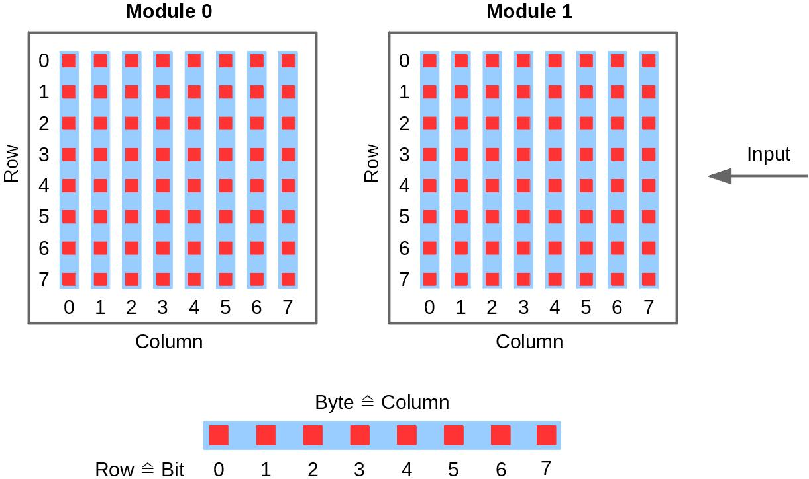

# MaxMatrix
This is an Arduino library for chained 8x8 LED dot matrix modules driven by the MAX7219.

Features:

- set and get single dots, rows and columns
- print chars and text (ASCII 32 to 126 and German umlauts, variable char width)
- scroll a char or a text over the matrix without blocking `loop()`
- shift the matrix content left, right, up and down, with or without rotation
- module orientation of 0, 90, 180 and 270 degrees
- bit banging (any pins) or hardware SPI

## Installation
Download the repository as ZIP and add it in the Arduino IDE with *Sketch > Include Library > Add .ZIP Library...*,
or clone it into your `Arduino/libraries` folder.

## Wiring

| Module | Arduino Uno / Nano |
|--------|--------------------|
| VCC    | 5V                 |
| GND    | GND                |
| DIN    | 11                 |
| CS     | 10                 |
| CLK    | 13                 |

In bit banging mode any digital pins can be used. With hardware SPI, DIN and CLK must be connected to the SPI pins of the board (MOSI and SCK).

## Configuration
The configuration is done in [MaxMatrix.h](MaxMatrix.h):

| Parameter                                  | Default   | Description                                           |
|--------------------------------------------|-----------|-------------------------------------------------------|
| `MAXMATRIX_NUMBER_OF_MODULES`              | `4`       | number of chained 8x8 modules                         |
| `MAXMATRIX_USE_SPI`                        | `STD_OFF` | use hardware SPI instead of `shiftOut()`              |
| `MAXMATRIX_SPI_CLOCK_SPEED`                | `10000000`| SPI clock, the MAX7219 supports max. 10 MHz           |
| `MAXMATRIX_USE_DIGITAL_WRITE_FAST`         | `STD_OFF` | use the digitalWriteFast library for the chip select  |
| `MAXMATRIX_SPACE_BETWEEN_CHARS_INIT_VALUE` | `1`       | empty columns between chars                           |
| `MAXMATRIX_INTENSITY_INIT_VALUE`           | `5`       | LED intensity after `init()` (0 to 15)                |

## Usage

```cpp
#include <MaxMatrix.h>

MaxMatrix Matrix(11, 10, 13);   // DIN, CS, CLK
char Text[] = "Hello World!   ";

void setup()
{
    Matrix.init();
    Matrix.setModuleOrientation(MAXMATRIX_MODULE_ORIENTATION_90);
    Matrix.setTextWithShift(Text);
}

void loop()
{
    Matrix.shiftTask();     // shifts the text one column per call
    if(Matrix.getState() == MAXMATRIX_STATE_READY) Matrix.setTextWithShift(Text);
    delay(50);
}
```

`setTextWithShift()` only stores a pointer to the text, so the text has to stay valid until the state changes back to `MAXMATRIX_STATE_READY`.

More examples can be found in [examples/](examples/).

## Module orientation
Depending on how the LED matrix is mounted on the module, the columns of the MAX7219 are horizontal or vertical.
Use `setModuleOrientation()` to select the orientation that matches your modules: if the text is rotated or mirrored, try another orientation.

Orientation 0 / 180 degrees:



Orientation 90 / 270 degrees:


## Umlauts
The German umlauts Ä, Ö, Ü, ä, ö and ü are supported in texts. `setText()` and `setTextWithShift()` accept UTF-8 (the encoding of the Arduino IDE) and ISO 8859-1.
`setChar()` and `setCharWithShift()` take a single `char`, so umlauts have to be passed as ISO 8859-1 code there, e.g. `'\xE4'` for ä.
While shifting a text, chars which are not part of the font are skipped.

## Development
The host-side tests build the library against a mock of the Arduino core, once with bit banging and once with SPI:

```sh
cmake --workflow --preset default
```

They need `g++`, CMake, Ninja and GoogleTest (`apt install cmake ninja-build libgtest-dev`). Compiling the examples with the real AVR toolchain needs `arduino-cli` with the `arduino:avr` core:

```sh
arduino-cli compile --fqbn arduino:avr:uno --library . examples/ScrollText
```

Both run in CI on every pull request, together with `arduino-lint`.
