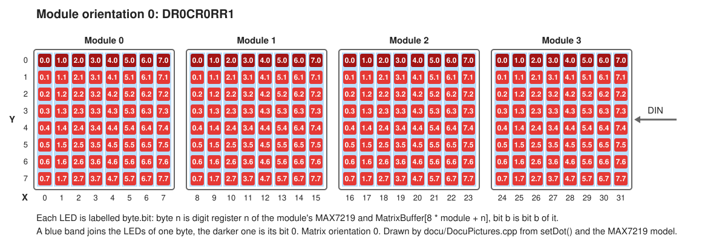
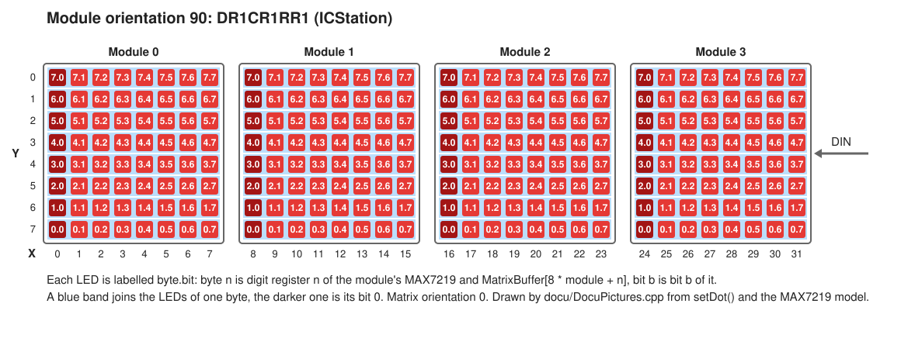
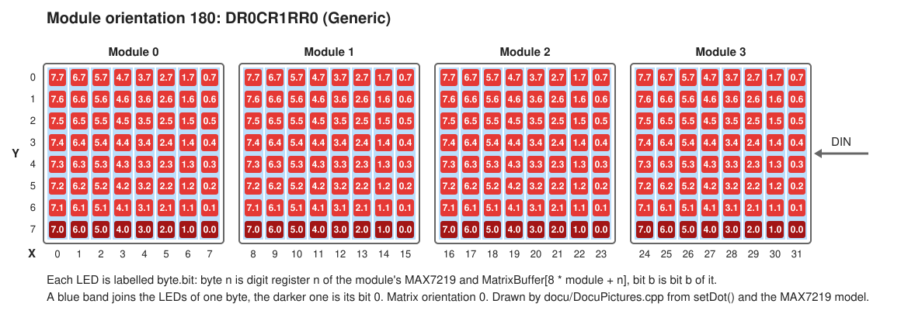
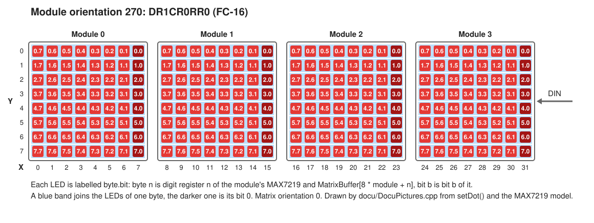

# How the modules are wired

A sketch never sees this: it works in the coordinates of [Coordinates.svg](Coordinates.svg), which are the same
in every module orientation once it fits the module. The pictures below are for working on `src/Matrix/`, where
`MaxMatrixPanel::convertDotToBuffer()` maps a dot as the viewer sees it to a byte and a bit of `MatrixBuffer`.

Each LED is labelled `byte.bit`. Byte *n* of a module is digit register *n* of its MAX7219 and
`MatrixBuffer[8 * module + n]`; the library sends the same byte of every module in one frame. A blue band joins
the LEDs of one byte, and the darker LED is its bit 0. All pictures are in matrix orientation 0; matrix
orientation 180 turns the whole panel on top of them.

## Module orientation 0



## Module orientation 90



## Module orientation 180



## Module orientation 270



## Where the pictures come from

`DocuPictures.cpp` draws them, with `DocuSvg` for the SVG. It places every LED by calling the library and asking the
MAX7219 model in `test/mock/` which register bit of which chip it latched; the module types in the titles are the
wirings of the model on which a pattern drawn in that orientation appears upright. So no picture is drawn by hand,
and none can say what the library does not do.

After a change that moves a dot, write them again:

```sh
build/DocuPictures --write docu
```

The test `docu/pictures` runs `DocuPictures --check docu` and fails as long as a picture here is not what the library
draws.
